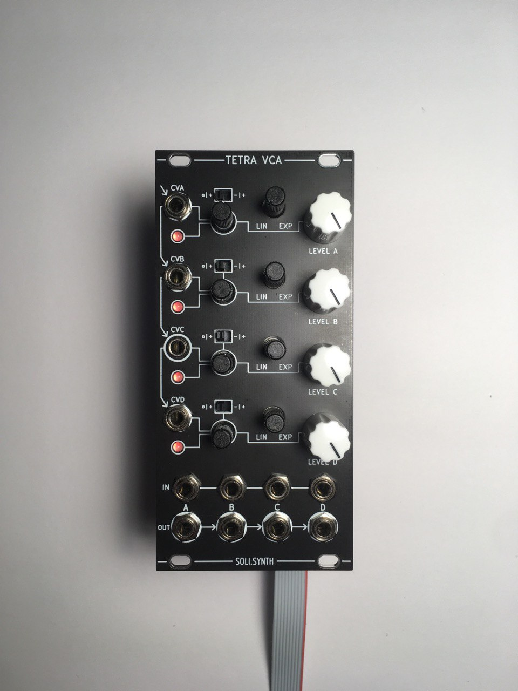

# TETRA VCA #

### Quad Linear/Exponential VCA and Mixer ###

  

TETRA VCA has four voltage-controlled amplifiers in 12 HP, built around the SSM2164 quad VCA chip. Each channel has a level knob, a CV input with an amount knob and a switch to use it as an attenuator or an attenuverter, and a knob that blends the response from linear to exponential, so it works just as well for shaping envelopes on audio as for processing CV.

The CV inputs are normalled from one channel to the next: a single CV patched into channel A also controls B, C and D until you patch something else further down. The outputs are normalled too: unpatched outputs are summed into the next channel, so the module also works as a four-channel mixer with the last output carrying the mix.
A bicolour LED per channel shows the level of the incoming CV voltage. Green for negative and red for positive voltages.

## Get one
TETRA VCA is available from [Solisynth](https://solisynth.com/).

## Features
- 4 VCAs based on the SSM2164
- Linear to exponential response knob per channel
- Level (offset) knob per channel
- CV input with amount knob per channel
- Attenuator / attenuverter switch for each CV input
- CV inputs normalled A → B → C → D
- Outputs normalled into the next channel: unpatched channels mix into the following output
- Bicolour LED per CV input

## Specifications
| | |
|---|---|
| Width | 12 HP |
| Depth | 45 mm |
| Power +12 V | TBD |
| Power −12 V | TBD |

## Hardware
The schematics and PCB layouts are KiCad projects:

- `tetra-vca-main-pcb/`: main PCB and jack/control board (schematic split into one sheet per channel plus the power supply)
- `tetra-vca-frontpanel-pcb/`: front panel

The bill of materials is in [`tetra-vca-main-pcb/bom/TetraVCA_BOM.csv`](tetra-vca-main-pcb/bom/TetraVCA_BOM.csv). Gerbers can be generated from the KiCad projects.

## Repository structure
| Folder | Contents |
|---|---|
| `tetra-vca-main-pcb/` | KiCad project for the PCBs, BOM |
| `tetra-vca-frontpanel-pcb/` | KiCad project for the front panel |
| `pictures/` | Photos of the module |

## License
TETRA VCA is open source:

- Hardware: [CERN-OHL-S-2.0](LICENSES/CERN-OHL-S-2.0.txt)
- Documentation: [CC-BY-SA-4.0](LICENSES/CC-BY-SA-4.0.txt)

If you share a modified version or hardware built from these files, it has to stay open source under the same license.
"Solisynth", "TETRA VCA" and the Solisynth logo are not covered by these licenses: derivatives must use their own name and branding. See [LICENSE.md](LICENSE.md) for details.
